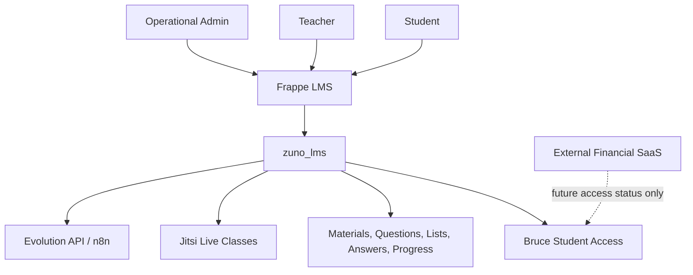

# Architecture — Zuno / zuno_lms

## 1. System Overview

Zuno is a focused education platform layer built on top of Frappe LMS for
Professor Bruce's ENEM / Ciências Humanas course context.
`zuno_lms` is the custom Frappe app that contains the
project-specific LMS behavior.

The system supports students, Professor Bruce, and operational/admin users. It
handles pedagogical operations: live classes, access control, educational
materials, ENEM questions, exercise lists, student answers, progress,
dashboards, and communication preparation.

Financial and commercial operations are outside this repository.

## 2. Architecture Goals

- Preserve upgradeability of Frappe and Frappe LMS.
- Keep custom logic isolated in `zuno_lms`.
- Enforce backend permissions for sensitive behavior.
- Keep the student experience simple.
- Keep teacher/admin workflows operationally clear.
- Keep user-facing UI in Brazilian Portuguese.
- Protect secrets and student data.
- Prepare for production without premature complexity.

## 3. High-Level Architecture



Frappe LMS remains the LMS base. `zuno_lms` adds the
project-specific layer through Frappe extension points, custom DocTypes, pages,
backend methods, hooks, fixtures, patches, and scoped assets.

Integrations must be accessed through controlled backend logic or protected
flows. A future external financial SaaS may update pedagogical access status,
but billing logic must not move into this app.

## 4. Repository Boundary

Inside this app:

- pedagogical access;
- live classes;
- student pages;
- teacher dashboard;
- operational dashboard;
- educational materials;
- ENEM questions;
- exercise lists;
- student answers;
- student progress;
- WhatsApp notification preparation and logs.

Outside this app:

- checkout;
- subscription billing;
- CRM;
- lead capture;
- blog/newsletter;
- fiscal/accounting;
- banking reconciliation;
- full financial secretary workflows.

## 5. Technical Stack

- Frappe Framework.
- Frappe LMS / Frappe Learning.
- Python backend.
- Frappe DocTypes.
- Frappe Desk/pages.
- Frappe UI where applicable.
- Jitsi for live classes.
- Evolution API / n8n for WhatsApp preparation.
- MariaDB, Redis, and Frappe Bench as part of the Frappe environment.

## 6. Custom App Structure

`zuno_lms` is the customization layer. Custom DocTypes, pages,
whitelisted methods, hooks, fixtures, patches, and assets should live in this
app.

Core apps must remain untouched: do not modify Frappe, Frappe LMS, Frappe UI,
or Jitsi core directly.

Before adding new code, search existing patterns in `zuno_lms` and
extend them when they fit.

## 7. Core Domains

- Student Access: controls pedagogical access through `Bruce Student Access`.
- Live Classes: represents scheduled, live, ended, or canceled Jitsi classes.
- Student Home / "Minha Aula": gives students one simple entry point for class,
  materials, exercise lists, and progress.
- Educational Materials: manages published or internal learning resources.
- ENEM Question Bank: stores classified ENEM questions and answer metadata.
- Exercise Lists: groups published questions for student practice.
- Student Answers: records answers for the authenticated student and computes
  correctness server-side.
- Student Progress: calculates simple progress metrics from allowed lists and
  answers.
- Teacher Dashboard: supports class operation, live-room access, and recent
  class actions.
- Operational Dashboard: shows pedagogical operation health for authorized
  admins.
- WhatsApp / Evolution / n8n preparation: prepares, previews, sends where
  configured, and records communication attempts through protected flows.
- Logs and operational history: preserves class notices, send attempts, status,
  timestamps, and short error summaries without exposing secrets.

## 8. Data Model Summary

| Domain | Main DocType / Entity | Responsibility |
| ------ | --------------------- | -------------- |
| Student Access | Bruce Student Access | Stores pedagogical access status, student, course/batch scope, access window, and opaque external reference. |
| Live Classes | Bruce Live Class | Stores class metadata, LMS scope, instructor, Jitsi room data, status, and WhatsApp status. |
| Educational Materials | Bruce Educational Material | Stores learning materials, publication state, visibility, file/reference, and LMS scope. |
| ENEM Question Bank | Bruce ENEM Question | Stores ENEM question content, classification, answer key, resolution metadata, publication state, and LMS scope. |
| ENEM Alternatives | Bruce ENEM Question Alternative | Stores alternatives for ENEM questions. |
| Exercise Lists | Bruce Exercise List | Stores published exercise lists, LMS scope, related content, and publication state. |
| Exercise List Items | Bruce Exercise List Item | Links questions to exercise lists with ordering and optional points. |
| Student Answers | Bruce Student Answer | Stores the logged-in student's selected answer and server-computed correctness. |
| Jitsi Settings | Bruce Jitsi Settings | Stores non-sensitive Jitsi operational settings such as domain and room prefix. |
| WhatsApp Settings | Bruce Evolution Settings | Stores non-sensitive provider configuration and references to secrets kept outside Git/frontend. |
| WhatsApp Templates | Bruce WhatsApp Message Template | Stores Brazilian Portuguese WhatsApp message templates. |
| WhatsApp Logs | Bruce WhatsApp Notification Log | Records WhatsApp send/test attempts, status, timestamps, related class, and short errors. |
| Live Class History | Bruce Live Class Notice Log | Records operational events and notices for live classes. |

## 9. Access and Permission Architecture

Backend permission checks are mandatory. Frontend visibility is not
authorization.

Student identity must come from `frappe.session.user`. Students must not send
`student_user`, course, or batch from the frontend as trusted authorization
input. Student access is controlled by `Bruce Student Access`, and student
content must be scoped to the allowed course and/or batch.

Admin and teacher dashboards must reject normal students. Permission behavior
must match `docs/roles-permissions.md` and `SECURITY.md`.

Access statuses:

- "Ativo" unlocks pedagogical content.
- "Pendente", "Bloqueado", and "Expirado" do not unlock classes, materials,
  questions, exercise lists, answers, or progress metrics.

## 10. Main User Flows

Student opens "Minha Aula":

1. Backend identifies the logged-in student.
2. Backend checks `Bruce Student Access`.
3. If access is "Ativo", the page shows allowed class, materials, exercise
   lists, and progress.
4. If access is not active, the page shows a blocked/pending/expired state
   without releasing pedagogical metrics.

Student enters live class:

1. Student clicks "Entrar na aula".
2. Backend validates user, live class, status, room data, and access scope.
3. `/app/bruce-live-room/<class>` loads the embedded Jitsi room.
4. External Jitsi URL remains an explicit fallback.

Teacher starts/opens a live class:

1. Teacher uses "Painel do Professor" or the `Bruce Live Class` form.
2. Backend validates role, class status, and responsibility/scope.
3. The class opens in the internal live-room page and may move to "Ao vivo".

Admin reviews operational dashboard:

1. Admin opens "Painel Operacional".
2. Backend validates admin/operational role.
3. Dashboard returns only pedagogical aggregates and operational alerts.

WhatsApp notification attempt is logged:

1. Authorized user previews or sends a message through backend logic.
2. Provider call happens server-side or through protected n8n.
3. Attempt status, timestamp, related class, recipient summary, and short error
   are recorded.

Future external SaaS updates student pedagogical status:

1. External SaaS calls a protected backend endpoint.
2. Backend verifies the webhook and resolves student/course/batch.
3. Backend updates only `Bruce Student Access` status and opaque references.

## 11. Integration Architecture

### Jitsi

- Room names are generated server-side.
- Room names must be unique and non-predictable.
- Live room data is returned only after permission checks.
- `meet.jit.si` is acceptable for development/testing.
- Production should evaluate self-hosted Jitsi or Jitsi as a Service.

### WhatsApp / Evolution / n8n

- Provider calls must happen backend-side or through protected n8n.
- Provider secrets must never go to the frontend.
- Notification attempts are logged.
- Manual resend requires permission.

### External Financial SaaS

- Future only.
- Sends access-status updates to this LMS app.
- Webhook must be verified.
- Store only pedagogical status and opaque external references.
- Do not store card data or full financial payloads.

## 12. Frontend Architecture

Teacher/admin flows may use Frappe Desk where appropriate. Student-facing flows
should be simple, mobile-aware, and should not feel like administrative Desk.

Frontend work must follow `docs/design-system.md`. User-facing UI remains in
Brazilian Portuguese. Important screens need loading, empty, and error states.
Destructive actions require confirmation.

## 13. Backend Architecture

Backend is responsible for:

- authentication checks;
- authorization checks;
- student access validation;
- business rules;
- Jitsi room data protection;
- WhatsApp send/log flow;
- progress calculation;
- safe error handling;
- safe logging.

```txt
Request
  ↓
Authentication
  ↓
Authorization / Student Access Check
  ↓
Input Validation
  ↓
Business Logic
  ↓
Database / Integration
  ↓
Safe Response
```

## 14. Security Architecture

See `SECURITY.md` for the full policy.

- No secrets in Git.
- No provider keys in frontend code, HTML, browser responses, or logs.
- No real student data in the repository.
- Permission checks happen server-side.
- Logs must not contain secrets, auth headers, full provider tokens, or full
  sensitive payloads.
- Private student data must be scoped to the authenticated user and allowed
  course/batch.

## 15. Deployment and Operations

Production deployment still needs hardening.

- Secrets must use environment variables, site config, deployment secrets, or
  equivalent secure mechanisms.
- Backups must stay outside Git.
- Restore flow should be tested.
- Workers, scheduler, and Redis must be validated in production.
- Production Jitsi path must be decided.

## 16. Architectural Anti-Patterns

- Modifying core Frappe, Frappe LMS, Frappe UI, or Jitsi directly.
- Frontend-only authorization.
- Trusting user, course, or batch from frontend requests.
- Exposing API keys in Vue, HTML, or browser responses.
- Using predictable Jitsi room names.
- Putting financial SaaS responsibilities inside this app.
- Broad refactors during small tasks.
- Duplicating existing DocTypes, pages, or services without checking current
  patterns.
- Adding dependencies for trivial problems.

## 17. Architecture Decisions

| Decision | Status | Reason |
| -------- | ------ | ------ |
| Use Frappe LMS as base. | Active | Keeps the project aligned with LMS-native course, Desk, DocType, permission, and learning patterns. |
| Keep custom behavior in `zuno_lms`. | Active | Preserves upgradeability and avoids core modification. |
| Keep user-facing UI in Brazilian Portuguese. | Active | Matches the product audience and existing labels/statuses. |
| Keep internal docs in English. | Active | Gives future developers and AI agents one documentation language. |
| Use Jitsi for live classes. | Active | Supports embedded live classes through a known provider/API. |
| Use Evolution API/n8n for WhatsApp preparation. | Active | Keeps communication provider calls backend-side or protected. |
| Keep financial/commercial operations in external SaaS. | Active / Future integration only | Prevents the LMS from becoming billing, CRM, checkout, or financial operations software. |
| Avoid core modifications. | Active | Extension over core modification keeps Frappe and Frappe LMS upgrade-friendly. |

## 18. Related Documents

- `README.md`
- `README.en.md`
- `AGENTS.md`
- `ROADMAP.md`
- `SECURITY.md`
- `docs/design-system.md`
- `docs/roles-permissions.md`
- `docs/student-access-integration.md`
- `docs/jitsi-integration.md`
- `docs/ux-flows.md`
- `docs/testing-checklist.md`
- `docs/kpis-admin.md`
