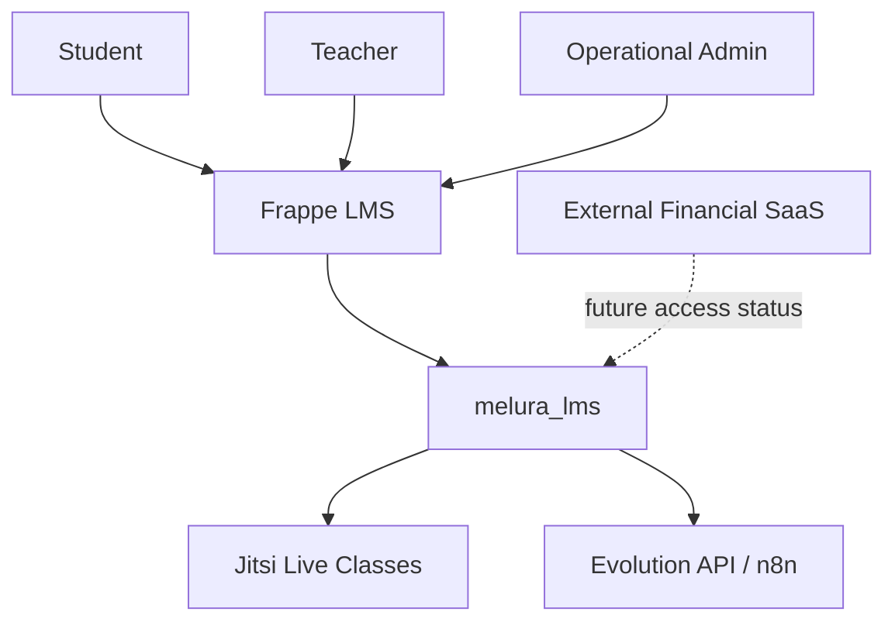

# Melura

[Versão em português: README.md](README.md)

Melura is a focused education platform layer built on top of Frappe LMS for live classes, student access, materials, exercises, progress, and operational visibility.

Current repository app: `melura_lms`.
Expected GitHub repository name: `melura-lms`.

## Overview

Melura customizes Frappe LMS for Professor Bruce's online ENEM / Ciências Humanas course. In this repository, Melura is the education product; `melura_lms` is the custom Frappe app that implements the specific rules, screens, DocTypes, permissions, and integrations.

The app is focused on pedagogical operations: students, teacher, content, live classes, exercises, progress, and operational administration. It is not the financial/commercial SaaS. User-facing UI remains in Brazilian Portuguese, and customization should continue without directly modifying Frappe, Frappe LMS, Frappe UI, or Jitsi core.

## Problem

Teachers and small education operations often rely on WhatsApp, manual links, scattered materials, manual access control, and weak operational visibility. This creates friction for students and increases work for the teacher and administration.

Students need a simple place to access live classes, materials, exercise lists, and progress. The teacher and operation need to control classes, access, communication, and indicators without technical complexity.

## Solution

Melura centralizes the pedagogical experience around Frappe LMS. Live classes, student access, materials, ENEM questions, exercise lists, answers, progress, and dashboards live in the LMS layer.

Communication can be prepared through WhatsApp using Evolution API or n8n, always through backend logic or a protected flow. Commercial and financial workflows stay outside this app and may integrate later only to update pedagogical access status.

## Core Features

- Student access control with `Bruce Student Access` - Done / mostly done.
- Student home / `Minha Aula` - Done / mostly done.
- Live class records - Done / mostly done.
- Embedded Jitsi live room - Functional, needs hardening.
- `Painel do Professor` - Done / mostly done.
- `Painel Operacional` - Done / mostly done.
- Educational materials - Done / mostly done.
- ENEM question bank - Done / mostly done.
- Exercise lists - Done / mostly done.
- Student answers - Done / mostly done.
- Student progress - Done / mostly done.
- WhatsApp/Evolution API preparation, logs, and testing - Functional, needs hardening.
- Security and permissions documentation - Done / mostly done.
- Design system documentation - Done / mostly done.
- External access status integration - Planned.
- PWA shell and refined mobile portal - Future.

## Architecture at a Glance

Melura uses the Frappe Framework and Frappe LMS / Frappe Learning as the base. The `melura_lms` app holds the pedagogical customizations. Jitsi supports live classes, Evolution API / n8n prepares WhatsApp communication, and an external SaaS owns financial and commercial operations.



## Repository Structure

- `AGENTS.md`: operational rules for agents and contributors.
- `README.md`: main README in Brazilian Portuguese.
- `README.en.md`: English version of this README.
- `ROADMAP.md`: product direction, phases, and scope boundaries.
- `SECURITY.md`: security policy, secrets, and authorization.
- `LICENSE`: MIT license.
- `docs/design-system.md`: UI, UX, language, and consistency rules.
- `docs/roles-permissions.md`: roles, permissions, and account separation.
- `docs/student-access-integration.md`: `Bruce Student Access` rules and future external integration.
- `docs/jitsi-integration.md`: Jitsi integration rules and implementation.
- `docs/ux-flows.md`: teacher, student, admin, Jitsi, WhatsApp, and progress flows.
- `docs/testing-checklist.md`: manual validation and future automation checklist.
- `docs/deployment/`: deployment and production-readiness documentation.
- `docs/backup-restore/`: policy, runbooks, and safe backup/restore validation checklist.
- `docs/kpis-admin.md`: reserved for admin KPI guidance when populated.
- `melura_lms/`: custom Frappe app code.

## Local Development

Use a local Frappe bench with Frappe LMS installed. Example directory used in this environment:

```bash
cd ~/Projetos/frappe-bench
```

Python validation:

```bash
./env/bin/python -m compileall apps/melura_lms/melura_lms
```

Unit tests:

```bash
./env/bin/python -m unittest discover \
  -s apps/melura_lms/melura_lms \
  -t apps/melura_lms \
  -p "test_*.py"
```

Cache and build:

```bash
bench --site curso.localhost clear-cache
bench --site curso.localhost clear-website-cache
bench build --app melura_lms
```

Migration should be used only when schema, DocType, fixture, or patch changes require it:

```bash
bench --site curso.localhost migrate
```

## Configuration

Secrets must stay outside Git. Use environment variables, `site_config.json` outside the repository, deployment secrets, or an equivalent secure mechanism.

Examples of sensitive values:

- Evolution API key;
- webhook secrets;
- future external SaaS webhook secret;
- future Jitsi/JaaS credentials.

Provider credentials must never be exposed to the frontend, rendered in HTML, returned by browser APIs, or logged in full.

## Security

See [SECURITY.md](SECURITY.md) for the full policy.

Backend authorization is mandatory. Frontend visibility is not authorization. `Bruce Student Access` controls pedagogical access: only `Ativo` unlocks content, classes, materials, questions, lists, answers, and progress. Students must not access content outside their allowed course or batch.

Related reading:

- [SECURITY.md](SECURITY.md)
- [docs/roles-permissions.md](docs/roles-permissions.md)
- [docs/student-access-integration.md](docs/student-access-integration.md)

## Roadmap

The pedagogical MVP core is largely built, but several hardening and operational readiness tracks remain:

- permission audit;
- cache/performance basics;
- deployment readiness;
- backup/restore validation;
- external student status integration;
- real WhatsApp sending/retry flow;
- production Jitsi decision;
- paused mobile student portal refinement;
- future PWA shell.

See [ROADMAP.md](ROADMAP.md).

## Out of Scope

This custom Frappe LMS app should not include by default:

- checkout;
- subscription billing;
- split payment;
- banking reconciliation;
- fiscal/accounting features;
- full CRM;
- blog;
- newsletter;
- lead capture;
- advanced marketing automation;
- native mobile app before mobile web/PWA is stable;
- direct modifications to Frappe, Frappe LMS, Frappe UI, or Jitsi core.

These responsibilities may belong to another repository or an external SaaS, not to the `melura_lms` pedagogical core.

## Documentation

- [AGENTS.md](AGENTS.md): mandatory instructions for agents and contributions.
- [SECURITY.md](SECURITY.md): security policy, secrets, authorization, and vulnerabilities.
- [ROADMAP.md](ROADMAP.md): product direction, phases, backlog, and limits.
- [docs/design-system.md](docs/design-system.md): UI, UX, language, accessibility, and visual patterns.
- [docs/roles-permissions.md](docs/roles-permissions.md): roles, permissions, and account separation.
- [docs/student-access-integration.md](docs/student-access-integration.md): pedagogical access source and future external integration.
- [docs/jitsi-integration.md](docs/jitsi-integration.md): live classes, embedded room, and Jitsi rules.
- [docs/ux-flows.md](docs/ux-flows.md): operational flows for student, teacher, admin, WhatsApp, and progress.
- [docs/testing-checklist.md](docs/testing-checklist.md): manual validation and future automation.
- [docs/deployment/00-overview.md](docs/deployment/00-overview.md): deployment and production-readiness overview.
- [docs/backup-restore/00-overview.md](docs/backup-restore/00-overview.md): backup, restore, retention, and safe validation overview.
- [docs/kpis-admin.md](docs/kpis-admin.md): reserved for admin KPIs when populated.

## License

This project is licensed under the MIT License. See [LICENSE](LICENSE).

## Maintainer

Estevão Oliveira Portes
