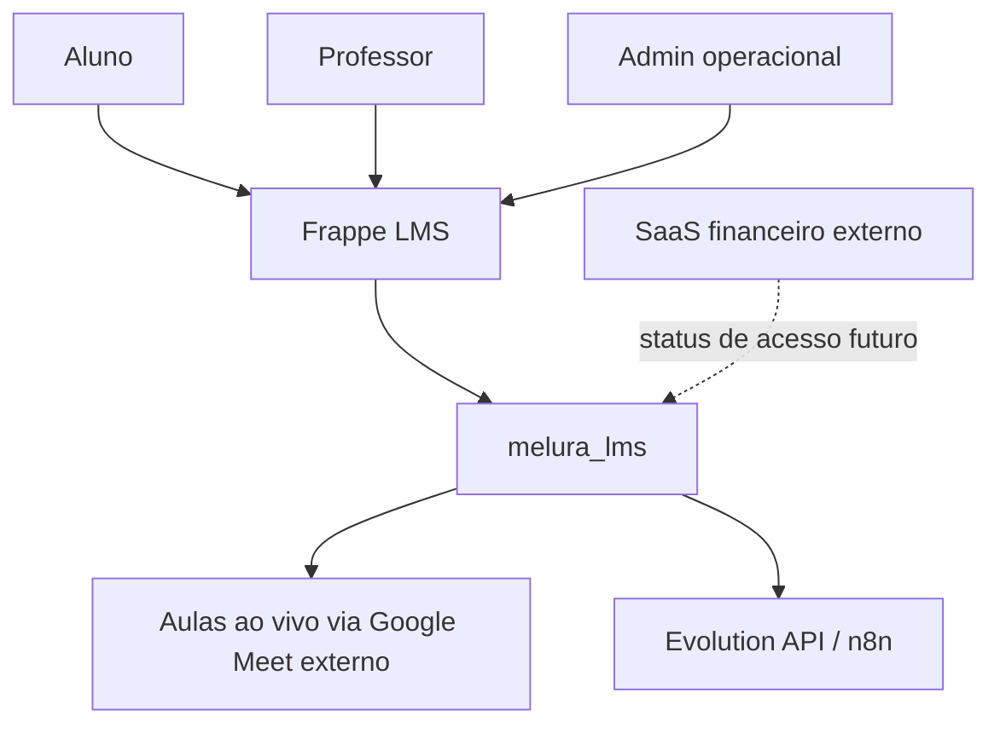

# Melura

[English version: README.en.md](README.en.md)

Melura é uma camada educacional construída sobre o Frappe LMS para aulas ao vivo, controle de acesso, materiais, exercícios, progresso e visibilidade operacional.

Aplicativo atual do repositório: `melura_lms`.
Nome esperado do repositório GitHub: `melura-lms`.

## Visão geral

Melura customiza o Frappe LMS para uma operação online de ENEM / Ciências Humanas. Neste repositório, Melura é o produto educacional; `melura_lms` é a app Frappe customizada que implementa as regras, telas, DocTypes, permissões e integrações específicas.

A app é focada na operação pedagógica: alunos, professor, conteúdos, aulas ao vivo, exercícios, progresso e administração operacional. Ela não é o SaaS financeiro/comercial. A experiência visível ao usuário final permanece em português brasileiro, e a customização deve continuar sem modificar diretamente o core do Frappe, Frappe LMS ou Frappe UI.

## Problema

Professores e pequenas operações educacionais frequentemente dependem de WhatsApp, links manuais, materiais espalhados, controle de acesso manual e pouca visibilidade operacional. Isso cria atrito para o aluno e aumenta o trabalho do professor e da administração.

O aluno precisa de um lugar simples para encontrar a aula ao vivo, materiais, listas de exercícios e progresso. O professor e a operação precisam controlar aulas, acessos, comunicação e indicadores sem complexidade técnica.

## Solução

Melura centraliza a experiência pedagógica em torno do Frappe LMS. Aulas ao vivo, acesso do aluno, materiais, questões ENEM, listas de exercícios, respostas, progresso e painéis ficam na camada LMS.

A comunicação pode ser preparada por WhatsApp usando Evolution API ou n8n, sempre por backend ou fluxo protegido. Fluxos comerciais e financeiros ficam fora desta app e podem integrar no futuro apenas para atualizar status pedagógico de acesso.

No Frappe Desk, o Workspace `Melura` centraliza os atalhos operacionais da app.
Usuários devem acessar aulas, painéis, WhatsApp, conteúdos e acessos por esse
Workspace em `/app`, sem precisar digitar rotas diretas. Algumas rotas e
DocTypes internos ainda mantêm nomes técnicos legados para compatibilidade, mas
os rótulos visíveis devem usar Melura ou nomes neutros em português brasileiro.

## Funcionalidades principais

- Controle de acesso pedagógico do aluno - Concluído / quase concluído.
- Página do aluno / `Minha Aula` - Concluído / quase concluído.
- Registros de aulas ao vivo - Concluído / quase concluído.
- Aula ao vivo com link externo do Google Meet - Funcional.
- Geração automática de aulas por agenda recorrente - Fundação adicionada.
- Workspace `Melura` no Frappe Desk para navegação central - Funcional.
- `Painel do Professor` - Concluído / quase concluído.
- `Painel Operacional` - Concluído / quase concluído.
- Materiais educacionais - Concluído / quase concluído.
- Banco de questões ENEM - Concluído / quase concluído.
- Listas de exercícios - Concluído / quase concluído.
- Respostas dos alunos - Concluído / quase concluído.
- Progresso do aluno - Concluído / quase concluído.
- Preparação, logs e teste de WhatsApp/Evolution API - Funcional, precisa de hardening.
- Documentação de segurança e permissões - Concluído / quase concluído.
- Documentação de design system - Concluído / quase concluído.
- Integração externa de status de acesso - Planejado.
- Shell PWA e portal mobile refinado - Futuro.

## Arquitetura em resumo

Melura usa o Frappe Framework e o Frappe LMS / Frappe Learning como base. A app `melura_lms` concentra as customizações pedagógicas. Aulas ao vivo usam links externos do Google Meet, Evolution API / n8n prepara comunicação via WhatsApp, e um SaaS externo fica responsável por operações financeiras e comerciais.



## Estrutura do repositório

- `AGENTS.md`: regras operacionais para agentes e contribuidores.
- `README.md`: README principal em português brasileiro.
- `README.en.md`: versão em inglês deste README.
- `ROADMAP.md`: direção do produto, fases e limites de escopo.
- `SECURITY.md`: política de segurança, segredos e autorização.
- `LICENSE`: licença MIT.
- `docs/design-system.md`: regras de UI, UX, linguagem e consistência.
- `docs/roles-permissions.md`: papéis, permissões e separação de contas.
- `docs/student-access-integration.md`: regras de acesso do aluno e integração externa futura.
- `docs/decisions/ADR-0002-google-meet-only-live-flow.md`: decisão de Google Meet externo como único fluxo de vídeo do MVP.
- `docs/development/naming-debt.md`: dívida de nomenclatura técnica legada.
- `docs/ux-flows.md`: fluxos de professor, aluno, admin, Google Meet, WhatsApp e progresso.
- `docs/testing-checklist.md`: checklist de validação manual e futura automação.
- `docs/deployment/`: documentação de prontidão de deploy e produção.
- `docs/backup-restore/`: política, runbooks e checklist de validação segura de backup e restore.
- `docs/kpis-admin.md`: reservado para orientação de KPIs administrativos quando preenchido.
- `melura_lms/`: código da app Frappe customizada.

## Desenvolvimento local

Use um bench Frappe local com Frappe LMS instalado. Exemplo de diretório usado neste ambiente:

```bash
cd ~/Projetos/frappe-bench
```

Validação Python:

```bash
./env/bin/python -m compileall apps/melura_lms/melura_lms
```

Testes unitários:

```bash
./env/bin/python -m unittest discover \
  -s apps/melura_lms/melura_lms \
  -t apps/melura_lms \
  -p "test_*.py"
```

Cache e build:

```bash
bench --site curso.localhost clear-cache
bench --site curso.localhost clear-website-cache
bench build --app melura_lms
```

Migração deve ser usada apenas quando houver mudança de schema, DocType, fixtures ou patches:

```bash
bench --site curso.localhost migrate
```

Mudanças em Workspaces padrão, como `melura_lms/melura_lms/workspace/melura/melura.json`,
também exigem `migrate` para sincronizar o registro no site.

## Configuração

Segredos devem ficar fora do Git. Use variáveis de ambiente, `site_config.json` fora do repositório, segredos de deploy ou mecanismo equivalente.

Exemplos de valores sensíveis:

- chave da Evolution API;
- segredos de webhook;
- segredo futuro de webhook do SaaS externo;
Não há credenciais de vídeo para este MVP: Google Meet é configurado como link externo, sem OAuth, API, SDK ou iframe.

Credenciais de provedores nunca devem ser expostas no frontend, renderizadas em HTML, retornadas por APIs de navegador ou registradas integralmente em logs.

## Segurança

Veja [SECURITY.md](SECURITY.md) para a política completa.

Autorização backend é obrigatória. Visibilidade no frontend não é autorização. O acesso do aluno controla a liberação pedagógica: somente `Ativo` desbloqueia conteúdo, aulas, materiais, questões, listas, respostas e progresso. A implementação ainda usa o DocType interno legado atualmente chamado `Bruce Student Access`, que será renomeado em uma migração futura. Alunos não devem acessar conteúdo fora do curso ou turma permitidos.

Leituras relacionadas:

- [SECURITY.md](SECURITY.md)
- [docs/roles-permissions.md](docs/roles-permissions.md)
- [docs/student-access-integration.md](docs/student-access-integration.md)

## Roadmap

O core MVP pedagógico está em grande parte construído, mas ainda existem frentes de hardening e preparação operacional:

- auditoria de permissões;
- fundamentos de cache e performance;
- prontidão de deploy;
- validação de backup e restore;
- integração externa de status do aluno;
- fluxo real de envio/retry de WhatsApp;
- automação de agenda e lembretes de aula ao vivo;
- portal mobile do aluno pausado para refinamento;
- shell PWA futuro.

Veja [ROADMAP.md](ROADMAP.md).

## Fora de escopo

Esta app Frappe LMS customizada não deve incluir por padrão:

- checkout;
- cobrança de assinatura;
- split payment;
- conciliação bancária;
- recursos fiscais/contábeis;
- CRM completo;
- blog;
- newsletter;
- captação de leads;
- automação avançada de marketing;
- app mobile nativo antes de mobile web/PWA estar estável;
- modificações diretas no core do Frappe, Frappe LMS ou Frappe UI;
- infraestrutura paga, gerenciada, auto-hospedada ou embutida de vídeo ao vivo.

Essas responsabilidades podem pertencer a outro repositório ou a um SaaS externo, não ao core pedagógico `melura_lms`.

## Documentação

- [AGENTS.md](AGENTS.md): instruções obrigatórias para agentes e contribuições.
- [SECURITY.md](SECURITY.md): política de segurança, segredos, autorização e vulnerabilidades.
- [ROADMAP.md](ROADMAP.md): direção do produto, fases, backlog e limites.
- [docs/design-system.md](docs/design-system.md): UI, UX, linguagem, acessibilidade e padrões visuais.
- [docs/roles-permissions.md](docs/roles-permissions.md): papéis, permissões e separação de contas.
- [docs/student-access-integration.md](docs/student-access-integration.md): fonte de acesso pedagógico e integração externa futura.
- [docs/decisions/ADR-0002-google-meet-only-live-flow.md](docs/decisions/ADR-0002-google-meet-only-live-flow.md): decisão de Google Meet externo.
- [docs/ux-flows.md](docs/ux-flows.md): fluxos operacionais de aluno, professor, admin, WhatsApp e progresso.
- [docs/testing-checklist.md](docs/testing-checklist.md): validações manuais e futuras automações.
- [docs/deployment/00-overview.md](docs/deployment/00-overview.md): visão geral de prontidão de deploy e produção.
- [docs/backup-restore/00-overview.md](docs/backup-restore/00-overview.md): visão geral de backup, restore, retenção e validação segura.
- [docs/kpis-admin.md](docs/kpis-admin.md): reservado para KPIs administrativos quando preenchido.

## Licença

Este projeto é licenciado sob a licença MIT. Veja [LICENSE](LICENSE).

## Mantenedor

Estevão Oliveira Portes
